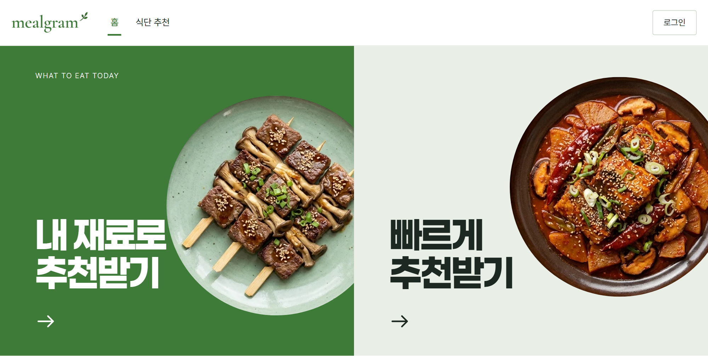
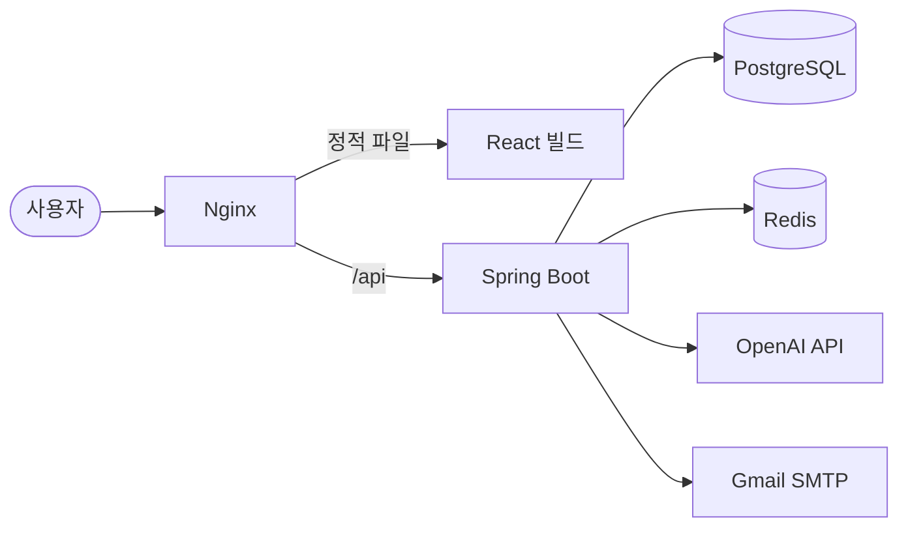
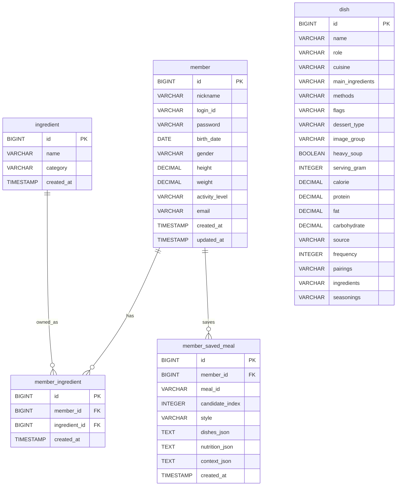

# mealgram

### 재료 기반 영양 균형 식단 추천

신체 정보, 목표, 냉장고 속 재료를 골라 영양 기준에 맞는 **한 끼 식단 3개를 AI에게 추천**받을 수 있습니다.

원하는 식단을 선택하고, **장보기 목록**을 확인해 요리해봐요!




<br>

**LINK**

[](https://mealgram.site)
[](https://mealgram.site/swagger-ui.html)
[](https://github.com/hg-proj/mealgram/actions/workflows/ci.yml)
<br>

[](https://github.com/1gyeolpark)
[](https://hg-proj.github.io/mealgram/gallery/)

<br>

## 목차

[기획 배경](#기획-배경) | [화면 UI](#화면-ui) | [주요 기능](#주요-기능) | [설치 및 실행](#설치-및-실행) | [기술 스택](#기술-스택)<br>
[개발 내용](#개발-내용) | [개발 타임라인](#개발-타임라인) | [ARCHITECTURE](#architecture) | [ERD](#erd) | [TROUBLESHOOTING](#troubleshooting) | [추가 및 개선](#추가-및-개선)

<br>

## 기획 배경

- 열량과 탄단지 비율을 맞춰 한 끼를 구성해주는 사이트의 필요를 느낌
- 전공을 살려 개인에게 맞는 식단을 추천해주는 사이트 구현
- 한국인 영양소 섭취기준을 기반으로 목표 열량과 탄단지 비율을 계산

<br>

## 화면 UI

- [mealgram 데스크톱, 모바일 화면 목록 사진으로 모아보기](https://hg-proj.github.io/mealgram/gallery/)
- 반응형 레이아웃, 모바일 지원

<br>

<details open>
<summary><h2>주요 기능</h2></summary>

### 메인

<video src="https://github.com/hg-proj/mealgram/raw/dev/docs/videos/01-main.mp4" controls muted playsinline width="100%"></video>

- 내 재료로 추천받기, 빠르게 추천받기 두 패널
- 빠른 추천 팝업에서 목표만 골라 바로 추천 가능
- 이용 방법과 오늘의 추천 식단 확인
- 새로고침으로 추천사진, 추천 식단 사진 변경됨

<br>

### 회원가입, 로그인

<video src="https://github.com/hg-proj/mealgram/raw/dev/docs/videos/02-signup-login.mp4" controls muted playsinline width="100%"></video>

- 이메일 인증번호 확인 후 가입
- 신체 정보는 선택 입력
- 아이디와 비밀번호로 로그인

<br>

### 비밀번호 찾기
<video src="https://github.com/hg-proj/mealgram/raw/dev/docs/videos/03-forgot-password.mp4" controls muted playsinline width="100%"></video>

- 이메일 입력해 인증번호 확인
- 새 비밀번호 설정

<br>

### 식단 추천, 내 식단

<video src="https://github.com/hg-proj/mealgram/raw/dev/docs/videos/04-meal-flow.mp4" controls muted playsinline width="100%"></video>

- 신체 정보(선택), 목표, 재료 3단계 입력
- 추천 식단 3개 확인, 상세에서 요리별 분량과 열량, 영양 비율 확인
- 내 식단에 저장, 사야 할 재료 목록 복사
- 메인의 추천 식단을 내 식단에 저장
- 저장한 식단 목록 확인과 삭제 

<br>

### 마이페이지

<video src="https://github.com/hg-proj/mealgram/raw/dev/docs/videos/05-mypage.mp4" controls muted playsinline width="100%"></video>

- 내 정보, 신체정보 확인과 수정
- 내 재료 저장
- 회원탈퇴

<br>

### 모바일

<video src="https://github.com/hg-proj/mealgram/raw/dev/docs/videos/06-mobile.mp4" controls muted playsinline width="320"></video>

- 헤더 햄버거 메뉴
- 빠르게 추천받기 팝업 모바일에서도 사용
- 카드와 입력창 한 줄로 쌓여 표시

</details>

<br>

<details>
<summary><h2>설치 및 실행</h2></summary>

### 사전 준비

- Java 21
- Node 22.22 이상
- Docker, Docker Compose

### 실행

```bash
cp .env.example .env
docker compose up -d --build
```

- `.env`에 적어 둔 주석대로 `JWT_SECRET` 작성
- 백엔드 API: http://localhost:8080, 화면은 아래 개발 모드의 프론트 실행으로 확인
- 메일 미설정 시 인증번호 `docker compose logs backend`에서 확인

### 개발 모드

```bash
docker compose up -d postgres redis
cd backend
./gradlew bootRun
```

```bash
cd frontend
npm install
npm run dev
```

프론트: http://localhost:5173

### 운영 배포

```bash
docker compose -f docker-compose.yml -f docker-compose.prod.yml up -d --build
```

- `.env`에 `DOMAIN` 작성
- HTTPS 인증서는 서버의 `/etc/letsencrypt`에 발급

</details>

<br>

## 기술 스택

**Backend**


**Frontend**


**AI, Infra**


<br>

## 개발 내용

| 구분 | 내용 |
| --- | --- |
| Backend | - 요리 956개를 규칙 기반으로 조합해 영양 기준에 맞는 식단 후보 구성<br>- AI가 후보 3개 선택과 이름 작성, 실패하면 규칙 후보로 대체<br>- 재료, 저장 식단, 장보기 목록 REST API 24개<br>- JWT Access/Refresh 토큰 인증, 이메일 인증번호 가입과 비밀번호 재설정<br>- 인증번호, 토큰, 호출 제한 관리<br>- 스키마 버전 관리, DB 포함 통합 테스트, 빌드와 테스트 자동 실행 |
| Frontend | - 메인, 로그인, 회원가입, 비밀번호 찾기 화면<br>- 식단 추천 3단계 입력, 후보와 상세, 장보기 목록<br>- 내 식단, 마이페이지<br>- 서버 상태 관리, 반응형 레이아웃 |

<br>

**데이터 출처**

- 학교 급식 식단: 나이스 교육정보 개방 포털 급식식단정보 API
- 식품 영양 성분: 식품의약품안전처 식품영양성분 데이터베이스
- 영양 기준: 2025 한국인 영양소 섭취기준(보건복지부, 한국영양학회)

<br>

## 개발 타임라인

| 날짜 | 내용 |
| --- | --- |
| 2026.09.14 | 프로젝트 시작 |
| 2026.09.14~09.20 | ERD, 컨벤션 문서, 프로젝트와 Docker Compose 구성 |
| 2026.10.01~10.09 | 백엔드 시작, 로그인, 재료, 식단 추천, 영양 검증, 마이페이지, 식단 저장 API 구현 |
| 2026.10.10~10.17 | 호출 제한, 오류 응답 통일, 보안 점검, 통합 테스트, CI 구성 |
| 2026.11.05~11.10 | 요리 사진, 랜덤 식단 조회, 비회원 식단 추천 등 추가 개발 |
| 2026.11.11~11.14 | 프론트엔드 시작, 메인, 로그인, 회원가입 화면 구현 |
| 2026.11.14~11.20 | 요리 조합 방식으로 전환, 장보기, 이메일 인증, 전체 화면 구현, 모바일 대응, Swagger와 배포 |

<br>

## ARCHITECTURE



- Nginx가 화면 요청은 React에, `/api` 요청은 Spring Boot에 전달
- PostgreSQL에는 회원과 식단 데이터, Redis에는 인증번호와 토큰을 저장
- 식단은 규칙으로 만들고 AI는 후보 선택과 이름 짓기만 담당
- Docker Compose로 AWS EC2 한 대에 배포

<br>

## ERD



[ERD 상세 문서](docs/ERD.md)

- 회원, 재료, 내 재료, 요리, 저장 식단 5개 테이블
- 추천 결과는 Redis에 24시간 보관, 저장할 때만 저장 식단 테이블에 복사
- 리프레시 토큰, 인증번호, 호출 제한은 Redis에서 관리

<br>

## TROUBLESHOOTING

<details>
<summary><b>레시피 검색 방식에서 영양과 구성이 어긋나던 문제</b></summary><br>

- **문제**: 레시피를 AI가 골라 식단으로 묶으면 열량과 탄단지가 목표와 어긋나고 밥, 국, 반찬 구성이 나오지 않음
- **원인**: 레시피 DB가 일품 요리 위주라서 한 끼 구성을 만들 수 없었음
- **해결**: 나이스 급식 API와 식약처 영양성분으로 요리 DB를 만들어 밥, 국, 메인, 곁들임으로 조합. AI는 후보 선택만 담당
- **트레이드오프**: 레시피 제공을 포기하고, 밥 국 반찬 구성과 목표 열량 맞춤을 얻음. 일부 영양 값은 유사 음식 기준 추정치

**변경 구조**
- 이전: 재료로 레시피 검색 → AI가 골라 식단으로 묶음
- 이후: 요리 조합 → 목표 열량 맞춤 → AI가 후보 3개 선택

<br>
</details>

<details>
<summary><b>네트워크가 잠깐 끊기면 로그인이 풀리던 문제</b></summary><br>

- **문제**: 요청 중 네트워크 오류가 나면 로그인 상태가 풀리고 캐시가 지워짐
- **원인**: 토큰 재발급이 실패하면 이유와 상관없이 로그아웃 처리. 서버가 거절한 경우와 연결하지 못한 경우를 구분하지 않음
- **해결**: 서버가 응답으로 거절했을 때만 토큰을 지우고, 네트워크 오류는 로그인 정보를 그대로 둠

**해결 전**
- `lib/axios.ts`
```ts
} catch {
  tokenStore.clear();
  queryClient.clear();
}
```

**해결 후**
- `lib/axios.ts`
```ts
} catch (reissueError) {
  if (isAxiosError(reissueError) && reissueError.response) {
    tokenStore.clear();
    queryClient.clear();
  }
}
```

<br>
</details>

<details>
<summary><b>메일 발송에 실패하면 비밀번호 재설정 인증번호를 다시 요청할 수 없던 문제</b></summary><br>

- **문제**: 메일 서버 오류로 인증번호 메일이 가지 않았는데, 60초 동안 다시 요청할 수 없음
- **원인**: 인증번호와 대기 시간을 먼저 저장한 뒤 메일을 보내서, 발송이 실패해도 값이 남음
- **해결**: 발송이 실패하면 저장한 인증번호와 대기 시간을 지우고 502로 응답

**해결 전**
- `AuthService.java`
```java
passwordResetCodeStore.save(member.getId(), code);

passwordResetMailer.send(member.getEmail(), member.getNickname(), code);
```

**해결 후**
- `AuthService.java`
```java
passwordResetCodeStore.save(member.getId(), code);

try {
    passwordResetMailer.send(member.getEmail(), member.getNickname(), code);
} catch (BusinessException e) {
    passwordResetCodeStore.delete(member.getId());
    passwordResetTokenStore.releaseCooldown(member.getId());

    throw e;
}
```

<br>
</details>

<details>
<summary><b>Redis가 멈추면 식단 추천까지 막히던 문제</b></summary><br>

- **문제**: Redis에 연결하지 못하면 호출 제한 검사에서 예외가 나서 식단 추천이 전부 실패
- **원인**: 호출 제한이 Redis에 의존해서, 제한 기능의 장애가 핵심 기능까지 번짐
- **해결**: 예외를 잡아 로그만 남기고 요청을 통과시킴. 그 밖의 저장소 장애는 503으로 응답

**해결 전**
- `MealRateLimitInterceptor.java`
```java
Long count = redisTemplate.opsForValue().increment(key);
```

**해결 후**
- `MealRateLimitInterceptor.java`
```java
try {
    count = redisTemplate.opsForValue().increment(key);
    ...
} catch (DataAccessException e) {
    log.warn("호출 제한 저장소에 연결하지 못해 제한 없이 통과시킵니다: {}", e.getClass().getSimpleName());
    return true;
}
```

<br>
</details>

<br>

## 추가 및 개선

**요리 데이터 확대와 레시피 제공**
- 급식 기반이라 한식이 대부분이고 영양 값 일부가 추정치입니다.
- 다양한 요리와 정확한 영양 데이터를 넣고 레시피도 제공하고 싶습니다.

**일주일 식단과 통합 장보기 목록**
- 지금은 한 끼 식단만 추천합니다.
- 식단표를 만들어 하루나 일주일 식단을 구성하고, 겹치는 재료를 묶어 한 번에 장볼 수 있게 하고 싶습니다.

**재료 주문 연결**
- 장보기 목록의 재료를 바로 주문할 수 있게 하고 싶습니다.
- 나아가 식단을 도시락이나 밀키트로 판매하는 서비스로 확장하고 싶습니다.

**AI 대화형 추천**
- 지금 AI는 후보 선택과 이름 짓기만 맡고 있습니다.
- "오늘 피곤하고 매운 게 당긴다"처럼 말하면 조건으로 바꾸고, 식단 수정도 대화로 처리하고 싶습니다.
