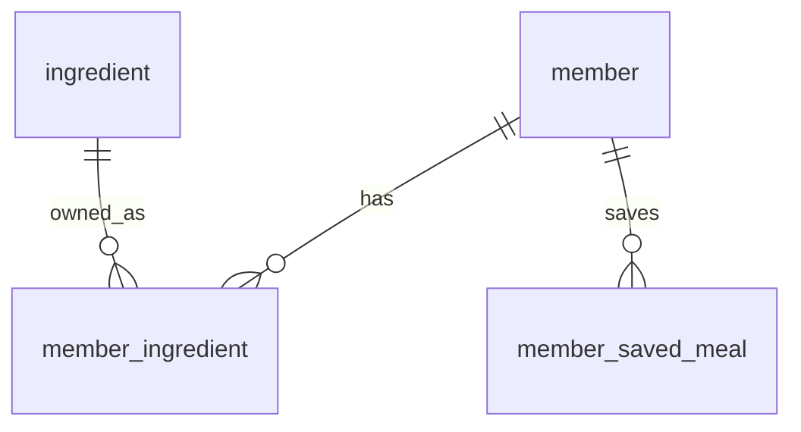
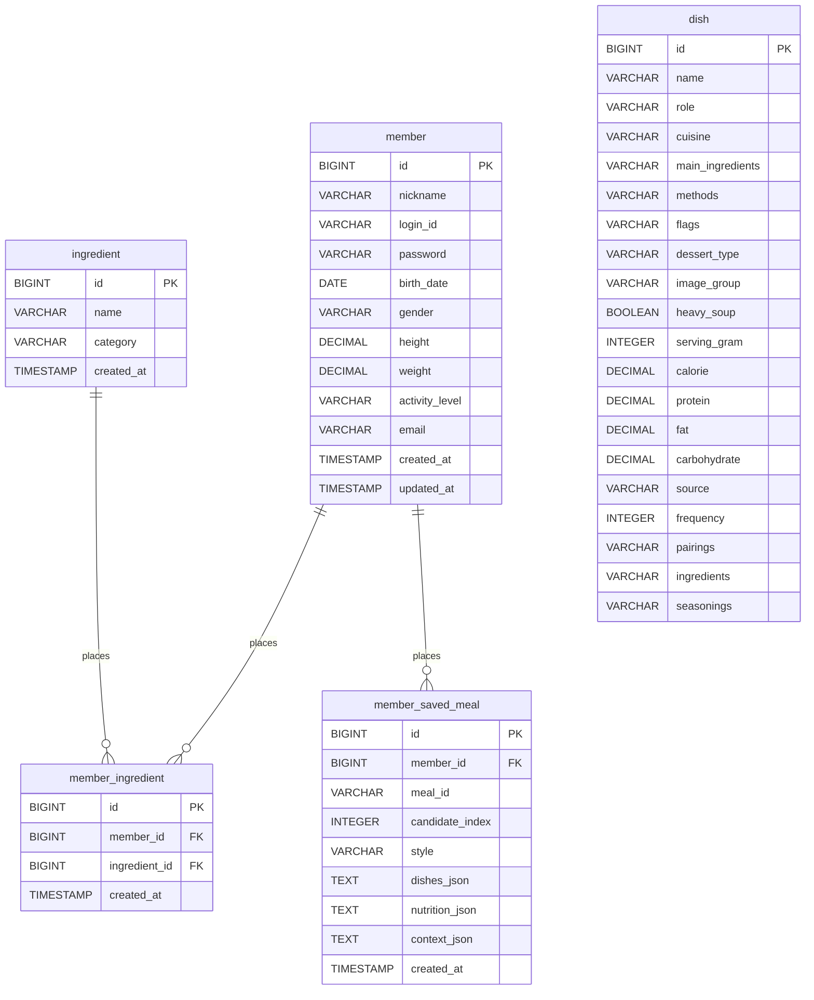

# mealgram erd

### 목차

- [mealgram erd](#mealgram-erd)
    - [목차](#목차)
    - [ERD 테이블 구조](#erd-테이블-구조)
    - [ERD 전체 구조](#erd-전체-구조)
    - [ERD 상세 구조](#erd-상세-구조)
  - [회원](#회원)
    - [member (회원)](#member-회원)
    - [member\_ingredient (회원 재료)](#member_ingredient-회원-재료)
    - [member\_saved\_meal (회원 저장식단)](#member_saved_meal-회원-저장식단)
  - [식단 재료](#식단-재료)
    - [dish (요리)](#dish-요리)
    - [ingredient (재료)](#ingredient-재료)

---

### ERD 테이블 구조

---

### ERD 전체 구조

---

### ERD 상세 구조

## 회원

### member (회원)

| 컬럼 | 타입 | 제약 |
| --- | --- | --- |
| id | BIGINT | PK |
| nickname (닉네임) | VARCHAR(10) | NOT NULL, 2~10자, 특수문자 허용, 중복허용 |
| login_id (아이디) | VARCHAR(20) | NOT NULL, UNIQUE, 영문 소문자+숫자 6~20자 |
| password (비밀번호) | VARCHAR(255) | NOT NULL, 해시 저장(BCrypt), 원문 규칙: 8~20자, 공백 불가, 영문+숫자+특수문자 중 3종류 이상이면 8자부터, 2종류면 10자 이상(KISA 패스워드 작성 규칙) |
| birth_date (생년월일) | DATE | nullable, 만 3세 이상 120세 이하, 마이페이지에서 입력/수정 가능, 나이는 저장하지 않고 열량 계산 때 만 나이로 계산 |
| gender (성별) | VARCHAR(10) | nullable, Java enum Gender(MALE/FEMALE) |
| height (키) | DECIMAL | nullable, 50~250cm |
| weight (몸무게) | DECIMAL | nullable, 10~300kg |
| activity_level (활동량) | VARCHAR(20) | nullable, Java enum ActivityLevel(비활동적/저활동적/활동적/매우활동적) |
| email (이메일) | VARCHAR | NOT NULL, UNIQUE, 소문자로 저장(CHECK email = lower(email)) |
| created_at (가입일시) | TIMESTAMP | NOT NULL |
| updated_at (수정일시) | TIMESTAMP | NOT NULL |

### member_ingredient (회원 재료)

| 컬럼 | 타입 | 제약 |
| --- | --- | --- |
| id | BIGINT | PK |
| member_id (회원id) | BIGINT | FK → member.id, ON DELETE CASCADE |
| ingredient_id (재료id) | BIGINT | FK → ingredient.id, UNIQUE(member_id, ingredient_id), INDEX, ON DELETE CASCADE |
| created_at (등록일시) | TIMESTAMP | NOT NULL |

### member_saved_meal (회원 저장식단)

추천받은 식단 한 상을 그대로 저장. 추천 결과는 Redis에 24시간만 남으므로, 저장할 때 요리 목록과 영양을 JSON 텍스트로 복사해 둠

| 컬럼 | 타입 | 제약 |
| --- | --- | --- |
| id | BIGINT | PK |
| member_id (회원id) | BIGINT | FK → member.id, ON DELETE CASCADE |
| meal_id (추천 결과id) | VARCHAR(36) | NOT NULL, 저장한 추천 결과의 id |
| candidate_index (후보 번호) | INTEGER | NOT NULL, 0~2 |
| style (식단 이름) | VARCHAR(50) | NOT NULL |
| dishes_json (요리 목록) | TEXT | NOT NULL, 요리 이름, 분량, 열량 등 |
| nutrition_json (영양 정보) | TEXT | NOT NULL |
| context_json (추천 조건) | TEXT | NULL 허용, 목표, 성향, 장르, 필수 재료, 가진 재료 |
| created_at (저장일시) | TIMESTAMP | NOT NULL |

UNIQUE(member_id, meal_id, candidate_index): 같은 추천 결과의 같은 식단을 두 번 저장할 수 없음

---

## 식단 재료

### dish (요리)

학교 급식 식단과 식품영양성분 데이터에서 정리한 요리. 식단은 이 요리들을 규칙에 따라 조합해서 만듦

| 컬럼 | 타입 | 제약 |
| --- | --- | --- |
| id | BIGINT | PK |
| name (요리명) | VARCHAR(50) | NOT NULL |
| role (역할) | VARCHAR(20) | NOT NULL, RICE(밥), SOUP(국), MAIN(메인 반찬), SIDE(곁들임 반찬), PICKLE(김치와 절임), DESSERT(후식), ONE_DISH(일품, 면과 덮밥처럼 그 자체로 한 끼가 되는 요리) |
| cuisine (장르) | VARCHAR(10) | NOT NULL, 한식, 중식, 일식, 양식 등 |
| main_ingredients (주재료) | VARCHAR(100) | NOT NULL, 재료 목록에서 계산한 큰 분류(소고기, 돼지고기, 닭고기, 오리, 생선, 해산물, 두부콩, 달걀), 없으면 빈 문자열 |
| methods (조리법) | VARCHAR(100) | NOT NULL, 쉼표로 구분 |
| flags (특성) | VARCHAR(100) | NOT NULL, 쉼표로 구분(튀김, 고지방, 매운맛 등) |
| dessert_type (후식 종류) | VARCHAR(10) | nullable, 후식일 때만 |
| image_group (사진 묶음) | VARCHAR(10) | nullable, 같은 사진을 쓰는 요리끼리 같은 값 |
| heavy_soup (진한 국) | BOOLEAN | NOT NULL |
| serving_gram (기준 분량) | INTEGER | NOT NULL, g |
| calorie (열량) | DECIMAL | NOT NULL, 기준 분량 기준 |
| protein (단백질) | DECIMAL | NOT NULL |
| fat (지방) | DECIMAL | NOT NULL |
| carbohydrate (탄수화물) | DECIMAL | NOT NULL |
| source (영양 값 출처) | VARCHAR(30) | NOT NULL, 공식 값인지 유사 음식 참고 추정치인지 구분 |
| frequency (급식 등장 횟수) | INTEGER | NOT NULL, 자주 나오는 요리를 더 자주 고르는 데 씀 |
| ingredients (재료) | VARCHAR(300) | NOT NULL, 양념을 뺀 재료 이름을 쉼표로 구분(예: 제육볶음의 돼지고기, 양파, 당근), 재료 선택과 필수 재료 맞추기에 쓰고 장보기 목록의 바탕이 됨, 후식 중 재료가 없는 것은 빈 문자열 |
| seasonings (특수 양념) | VARCHAR(200) | NOT NULL, 장보기에만 쓰는 특수 양념 이름을 쉼표로 구분(예: 자장면의 춘장, 마파두부의 두반장), 집에 보통 있는 양념은 넣지 않음, 재료 선택에는 나오지 않음, 없으면 빈 문자열 |
| pairings (곁들임) | VARCHAR(200) | NOT NULL, 일품에 고정으로 곁들이는 요리 이름을 쉼표로 구분(예: 자장면의 단무지, 양파장아찌), 일품이 아니면 빈 문자열 |

UNIQUE(role, name)

### ingredient (재료)

| 컬럼 | 타입 | 제약 |
| --- | --- | --- |
| id | BIGINT | PK |
| name (재료명) | VARCHAR(50) | NOT NULL, UNIQUE |
| category (카테고리) | VARCHAR(20) | NOT NULL, 양념과 도구는 재료 선택 화면에 보이지 않음 |
| created_at (등록일시) | TIMESTAMP | NOT NULL |
